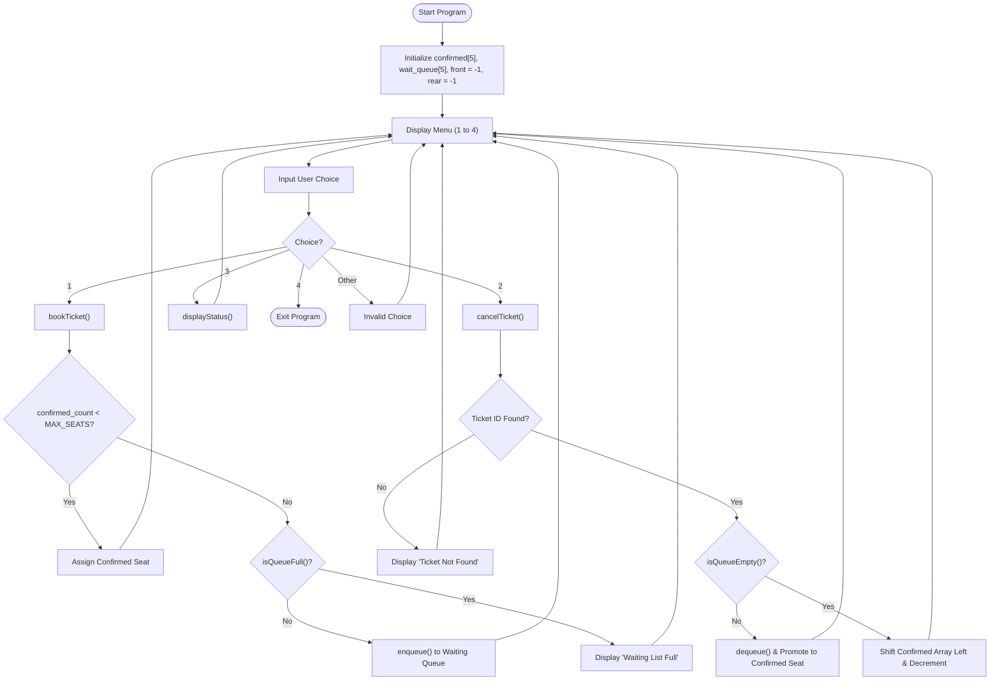

# Railway Reservation System using Queues

[](https://en.wikipedia.org/wiki/C_(programming_language))
[](https://en.wikipedia.org/wiki/C99)
[-brightgreen.svg)](https://en.wikipedia.org/wiki/Queue_(abstract_data_type))
[](LICENSE)

A console-based reservation management application built in **C** using **Structures**, **Arrays**, and a **Linear Queue (FIFO)**. It provides a menu-driven interface to book confirmed tickets, manage a waiting list queue of 5, automatically promote waiting passengers upon cancellation, and display live reservation statuses.

---

## Table of Contents
- [Project Overview](#project-overview)
- [Key Features](#key-features)
- [Design Decisions](#design-decisions)
- [System Flowchart](#system-flowchart)
- [Algorithms](#algorithms)
- [Source Code](#source-code)
- [Sample Execution Output](#sample-execution-output)
- [Compilation and Execution](#compilation-and-execution)

---

## Project Overview

The objective of this mini-project is to design and implement an efficient, fair **Railway Ticket Reservation and Waiting List Management System** using foundational Data Structures in C. When confirmed seat allocations reach maximum capacity, excess reservation requests are seamlessly placed into a **Waiting List Queue**.

### Supported Operations:
1. **Book Ticket:** Allocate confirmed berths; automatically route excess bookings into the waiting list queue.
2. **Cancel Ticket:** Cancel an existing confirmed ticket by ID and automatically promote the first waiting passenger to that seat.
3. **Display Status:** View all confirmed passengers and real-time waiting list queue positions in a formatted tabular layout.
4. **Exit:** Gracefully terminate the application.

---

## Key Features

- **Strict FIFO Fairness:** Waiting list allocations strictly respect order of arrival using First-In, First-Out queue semantics.
- **Dynamic Auto-Promotion:** Cancelling any confirmed ticket instantly promotes the passenger at the head of the waiting list without manual intervention.
- **Capacity Constraint Handling:** Configured with 5 confirmed berths and a 5-passenger waiting queue to prevent buffer overruns.
- **Contiguous Static Storage:** High cache locality with zero dynamic allocation overhead or memory leaks.
- **Input Buffer Safety:** Cleans input buffers to prevent multi-character scanner anomalies.

---

## Design Decisions

### 1. Data Structures: Passenger Structure with Array and Linear Queue
```c
#define MAX_SEATS 5
#define MAX_WAIT 5

typedef struct {
    int id;
    char name[30];
    int age;
} Passenger;

Passenger confirmed[MAX_SEATS];    // Confirmed berths
Passenger wait_queue[MAX_WAIT];    // Waiting List Linear Queue
int front = -1, rear = -1;         // Queue pointers
```

- **Why Queue (FIFO)?**  
  A Queue strictly implements **First-In, First-Out (FIFO)** discipline. In reservation systems, passenger fairness is paramount: the first traveler forced onto the waiting list (`front`) must be the very first to receive an available seat (`dequeue`) when a cancellation happens.
- **Why not Stack or Unordered Array?**  
  A Stack (LIFO) would unfairly reward the latest arrival. An unordered array would require costly $O(N)$ elements shifting on every dequeue. Pointers (`front` and `rear`) guarantee $O(1)$ queue operations.

### 2. Time & Space Complexity

| Operation | Best Case | Worst Case | Space Complexity |
| :--- | :---: | :---: | :---: |
| **Book Ticket (Confirmed)** | $O(1)$ | $O(1)$ | $O(1)$ |
| **Enqueue (Waiting List)** | $O(1)$ | $O(1)$ | $O(1)$ |
| **Dequeue (Auto-Promotion)** | $O(1)$ | $O(1)$ | $O(1)$ |
| **Cancel Ticket (Search)** | $O(1)$ | $O(N)$ | $O(1)$ |
| **Cancel Shift (No Waiting)** | $O(1)$ | $O(N)$ | $O(1)$ |
| **Display Status** | $O(N + M)$ | $O(N + M)$ | $O(1)$ |

---

## System Flowchart



---

## Algorithms

### 1. Ticket Booking (`bookTicket`)
1. Generate an auto-incremented `id` starting from 101.
2. Read passenger `name` using `scanf(" %29[^\n]", ...)`.
3. Read passenger `age`.
4. If `confirmed_count < MAX_SEATS`:
   - Store in `confirmed[confirmed_count]`.
   - Increment `confirmed_count`.
   - Display confirmation message with seat number.
5. Else:
   - Call `enqueue(passenger)`.

### 2. Waiting List Enqueue (`enqueue`)
1. If `isQueueFull()` (`rear == MAX_WAIT - 1`), display `"Waiting List is FULL"` and return.
2. If `front == -1`, set `front = 0`.
3. Increment `rear`.
4. Insert passenger: `wait_queue[rear] = p`.
5. Display waiting list position `(rear - front + 1)`.

### 3. Waiting List Dequeue (`dequeue`)
1. If `isQueueEmpty()` (`front == -1` or `front > rear`), return 0.
2. Retrieve head passenger: `*p = wait_queue[front]`.
3. Increment `front`.
4. If `front > rear`, reset queue pointers: `front = rear = -1`.
5. Return 1 (success).

### 4. Ticket Cancellation & Promotion (`cancelTicket`)
1. If `confirmed_count == 0`, display `"No confirmed tickets to cancel"` and return.
2. Prompt for target `id`.
3. Linearly search for `id` in `confirmed[]`.
4. If not found, display `"Ticket ID not found"`.
5. If found at index `found`:
   - Call `dequeue(&promoted)`.
   - If passenger was dequeued:
     - Place promoted passenger directly into `confirmed[found]`.
     - Display: `"Waiting list passenger PROMOTED to Confirmed Seat"`.
   - Else (waiting queue is empty):
     - For $i = \text{found}$ to `confirmed_count - 2`:
       - `confirmed[i] = confirmed[i + 1]`
     - Decrement `confirmed_count`.
     - Display cancellation confirmation.

### 5. Display Status (`displayStatus`)
1. Print Confirmed Bookings header with count (`confirmed_count / MAX_SEATS`).
2. Iterate $i = 0$ to `confirmed_count - 1` and print Seat No, Ticket ID, Name, and Age.
3. Print Waiting List Queue header.
4. If `isQueueEmpty()`, print `"Waiting list is empty"`.
5. Else, iterate $i = \text{front}$ to `rear` and print position rank (`WL #pos`), Ticket ID, Name, and Age.

---

## Source Code

The complete source code is available in [`railway_reservation.c`](railway_reservation.c):

```c
#include <stdio.h>
#include <string.h>
#include <stdlib.h>

#define MAX_SEATS 5
#define MAX_WAIT 5

// Structure to store passenger information
typedef struct {
    int id;
    char name[30];
    int age;
} Passenger;

// Confirmed list 
Passenger confirmed[MAX_SEATS];
int confirmed_count = 0;

// Waiting List Queue (FIFO) 
Passenger wait_queue[MAX_WAIT];
int front = -1, rear = -1;

int next_id = 101;

// Check if waiting queue is full 
int isQueueFull() {
    return (rear == MAX_WAIT - 1);
}

// Check if waiting queue is empty 
int isQueueEmpty() {
    return (front == -1 || front > rear);
}

// Enqueue a passenger into waiting list
void enqueue(Passenger p) {
    if (isQueueFull()) {
        printf("\nSorry, Waiting List is also FULL. Cannot book ticket.\n");
        return;
    }
    if (front == -1) front = 0;
    rear++;
    wait_queue[rear] = p;
    printf("\nConfirmed seats full! Passenger %s added to WAITING LIST (Position: %d, ID: %d).\n", 
           p.name, (rear - front + 1), p.id);
}

// Dequeue the first passenger from waiting list
int dequeue(Passenger *p) {
    if (isQueueEmpty()) return 0;
    *p = wait_queue[front++];
    if (front > rear) front = rear = -1; // reset queue
    return 1;
}

// Book a ticket
void bookTicket() {
    Passenger p;
    p.id = next_id++;

    printf("\nEnter Passenger Name: ");
    scanf(" %29[^\n]", p.name);
    printf("Enter Age: ");
    if (scanf("%d", &p.age) != 1) {
        printf("Invalid age entered.\n");
        while (getchar() != '\n'); // clear buffer
        return;
    }

    if (confirmed_count < MAX_SEATS) {
        confirmed[confirmed_count++] = p;
        printf("\nSuccess: Ticket CONFIRMED! (ID: %d, Name: %s, Seat No: %d)\n", 
               p.id, p.name, confirmed_count);
    } else {
        enqueue(p);
    }
}

// Cancel a ticket
void cancelTicket() {
    if (confirmed_count == 0) {
        printf("\nNo confirmed tickets to cancel.\n");
        return;
    }

    int id, found = -1;
    printf("\nEnter Ticket ID to cancel: ");
    if (scanf("%d", &id) != 1) {
        printf("Invalid input.\n");
        while (getchar() != '\n');
        return;
    }

    for (int i = 0; i < confirmed_count; i++) {
        if (confirmed[i].id == id) {
            found = i;
            break;
        }
    }

    if (found == -1) {
        printf("\nTicket ID %d not found in confirmed list.\n", id);
        return;
    }

    printf("\nTicket ID %d for %s CANCELLED successfully.\n", confirmed[found].id, confirmed[found].name);

    Passenger promoted;
    if (dequeue(&promoted)) {
        confirmed[found] = promoted;
        printf(">> Waiting list passenger %s (ID: %d) PROMOTED to Confirmed Seat %d!\n", 
               promoted.name, promoted.id, found + 1);
    } else {
        for (int i = found; i < confirmed_count - 1; i++) {
            confirmed[i] = confirmed[i + 1];
        }
        confirmed_count--;
    }
}

// Display reservation and queue status
void displayStatus() {
    printf("\n================ RESERVATION STATUS ================\n");
    printf("-- Confirmed Bookings (%d/%d) --\n", confirmed_count, MAX_SEATS);
    if (confirmed_count == 0) {
        printf("  No confirmed reservations.\n");
    } else {
        for (int i = 0; i < confirmed_count; i++) {
            printf("  Seat %d | ID: %d | Name: %-15s | Age: %d\n", 
                   i + 1, confirmed[i].id, confirmed[i].name, confirmed[i].age);
        }
    }

    printf("\n-- Waiting List Queue (Capacity: %d, FIFO) --\n", MAX_WAIT);
    if (isQueueEmpty()) {
        printf("  Waiting list is empty.\n");
    } else {
        int pos = 1;
        for (int i = front; i <= rear; i++) {
            printf("  WL #%d | ID: %d | Name: %-15s | Age: %d\n", 
                   pos++, wait_queue[i].id, wait_queue[i].name, wait_queue[i].age);
        }
    }
    printf("====================================================\n");
}

int main() {
    int choice;
    while (1) {
        printf("\n===== RAILWAY RESERVATION SYSTEM =====\n");
        printf("1. Book Ticket\n");
        printf("2. Cancel Ticket\n");
        printf("3. Display Status\n");
        printf("4. Exit\n");
        printf("Enter your choice: ");

        if (scanf("%d", &choice) != 1) {
            printf("Invalid choice. Exiting.\n");
            break;
        }

        switch (choice) {
            case 1: bookTicket(); break;
            case 2: cancelTicket(); break;
            case 3: displayStatus(); break;
            case 4: 
                printf("\nExiting system. Thank you!\n");
                return 0;
            default:
                printf("\nInvalid option! Please enter 1 to 4.\n");
        }
    }
    return 0;
}
```

---

## Sample Execution Output

```text
===== RAILWAY RESERVATION SYSTEM =====
1. Book Ticket
2. Cancel Ticket
3. Display Status
4. Exit
Enter your choice: 1

Enter Passenger Name: Rahul Sharma
Enter Age: 25

Success: Ticket CONFIRMED! (ID: 101, Name: Rahul Sharma, Seat No: 1)

===== RAILWAY RESERVATION SYSTEM =====
1. Book Ticket
2. Cancel Ticket
3. Display Status
4. Exit
Enter your choice: 1

Enter Passenger Name: Priya Patel
Enter Age: 28

Success: Ticket CONFIRMED! (ID: 102, Name: Priya Patel, Seat No: 2)

===== RAILWAY RESERVATION SYSTEM =====
1. Book Ticket
2. Cancel Ticket
3. Display Status
4. Exit
Enter your choice: 1

Enter Passenger Name: Amit Verma
Enter Age: 34

Success: Ticket CONFIRMED! (ID: 103, Name: Amit Verma, Seat No: 3)

===== RAILWAY RESERVATION SYSTEM =====
1. Book Ticket
2. Cancel Ticket
3. Display Status
4. Exit
Enter your choice: 1

Enter Passenger Name: Sneha Rao
Enter Age: 22

Success: Ticket CONFIRMED! (ID: 104, Name: Sneha Rao, Seat No: 4)

===== RAILWAY RESERVATION SYSTEM =====
1. Book Ticket
2. Cancel Ticket
3. Display Status
4. Exit
Enter your choice: 1

Enter Passenger Name: Vikram Singh
Enter Age: 40

Success: Ticket CONFIRMED! (ID: 105, Name: Vikram Singh, Seat No: 5)

===== RAILWAY RESERVATION SYSTEM =====
1. Book Ticket
2. Cancel Ticket
3. Display Status
4. Exit
Enter your choice: 1

Enter Passenger Name: Pooja Nair
Enter Age: 27

Confirmed seats full! Passenger Pooja Nair added to WAITING LIST (Position: 1, ID: 106).

===== RAILWAY RESERVATION SYSTEM =====
1. Book Ticket
2. Cancel Ticket
3. Display Status
4. Exit
Enter your choice: 1

Enter Passenger Name: Karan Mehta
Enter Age: 31

Confirmed seats full! Passenger Karan Mehta added to WAITING LIST (Position: 2, ID: 107).

===== RAILWAY RESERVATION SYSTEM =====
1. Book Ticket
2. Cancel Ticket
3. Display Status
4. Exit
Enter your choice: 3

================ RESERVATION STATUS ================
-- Confirmed Bookings (5/5) --
  Seat 1 | ID: 101 | Name: Rahul Sharma    | Age: 25
  Seat 2 | ID: 102 | Name: Priya Patel     | Age: 28
  Seat 3 | ID: 103 | Name: Amit Verma      | Age: 34
  Seat 4 | ID: 104 | Name: Sneha Rao       | Age: 22
  Seat 5 | ID: 105 | Name: Vikram Singh    | Age: 40

-- Waiting List Queue (Capacity: 5, FIFO) --
  WL #1 | ID: 106 | Name: Pooja Nair      | Age: 27
  WL #2 | ID: 107 | Name: Karan Mehta     | Age: 31
====================================================

===== RAILWAY RESERVATION SYSTEM =====
1. Book Ticket
2. Cancel Ticket
3. Display Status
4. Exit
Enter your choice: 2

Enter Ticket ID to cancel: 102

Ticket ID 102 for Priya Patel CANCELLED successfully.
>> Waiting list passenger Pooja Nair (ID: 106) PROMOTED to Confirmed Seat 2!

===== RAILWAY RESERVATION SYSTEM =====
1. Book Ticket
2. Cancel Ticket
3. Display Status
4. Exit
Enter your choice: 3

================ RESERVATION STATUS ================
-- Confirmed Bookings (5/5) --
  Seat 1 | ID: 101 | Name: Rahul Sharma    | Age: 25
  Seat 2 | ID: 106 | Name: Pooja Nair      | Age: 27
  Seat 3 | ID: 103 | Name: Amit Verma      | Age: 34
  Seat 4 | ID: 104 | Name: Sneha Rao       | Age: 22
  Seat 5 | ID: 105 | Name: Vikram Singh    | Age: 40

-- Waiting List Queue (Capacity: 5, FIFO) --
  WL #1 | ID: 107 | Name: Karan Mehta     | Age: 31
====================================================

===== RAILWAY RESERVATION SYSTEM =====
1. Book Ticket
2. Cancel Ticket
3. Display Status
4. Exit
Enter your choice: 4

Exiting system. Thank you!
```

---

## Compilation and Execution

### Using GCC (MinGW / Linux / macOS):
```bash
# Compile
gcc -std=c99 railway_reservation.c -o railway_reservation

# Run (Windows)
railway_reservation.exe

# Run (Linux / macOS)
./railway_reservation
```
